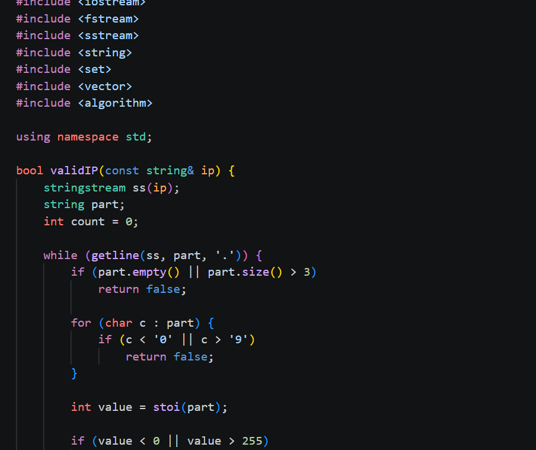
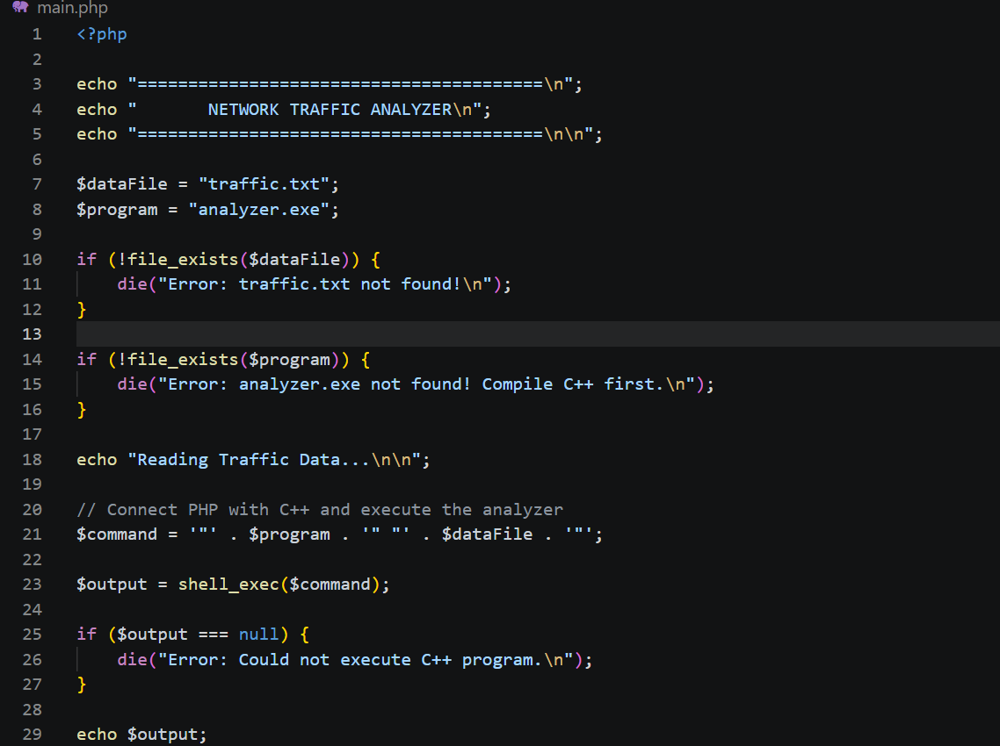
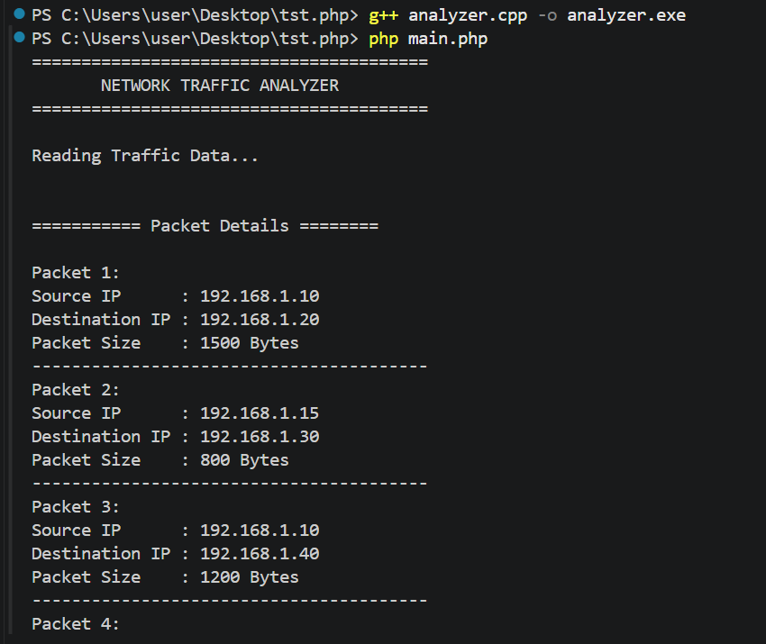
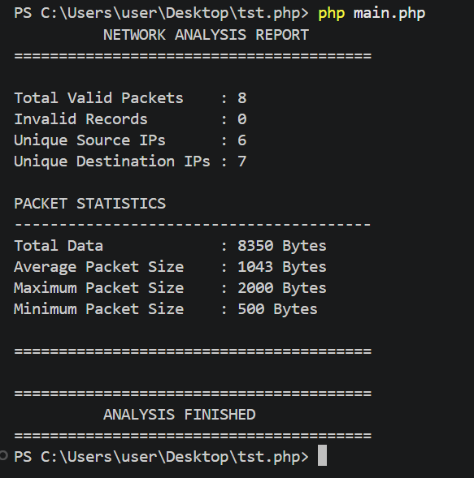

# Analyseur de trafic réseau (C++ / PHP)

Projet d'analyse de trafic réseau développé en **C++** et **PHP**. Il lit des enregistrements de trafic depuis un fichier texte, valide les adresses IPv4, analyse les paquets et génère un rapport statistique.

## Objectifs

- Analyser des enregistrements de trafic réseau
- Valider les adresses IPv4
- Afficher les adresses IP source et destination
- Calculer des statistiques sur les paquets
- Identifier la taille maximale, minimale et moyenne des paquets

## Technologies utilisées

| Technologie | Rôle |
|---|---|
| **C++** | Traitement des paquets, validation des IP et calculs statistiques |
| **PHP** | Interface principale et lancement du programme C++ |
| **Fichier texte** | Stockage des enregistrements de trafic |

## Structure du projet

| Fichier | Description |
|---|---|
| `analyzer.cpp` | Analyse et calculs (cœur du programme) |
| `main.php` | Programme principal et intégration avec le C++ |
| `traffic.txt` | Données d'entrée : enregistrements de trafic |
| `analyzer.exe` | Programme C++ compilé (généré par la compilation) |

## Fonctionnement

1. **Entrée :** lecture des enregistrements depuis `traffic.txt`.
2. **Validation :** vérification des adresses IPv4 et des tailles de paquets.
3. **Traitement :** analyse de chaque paquet et calcul des statistiques.
4. **Sortie :** affichage des détails des paquets et du rapport final.

## Format des données

Chaque ligne contient trois champs : `IP source, IP destination, taille du paquet`

Exemple :

```
192.168.1.10,192.168.1.20,1500
192.168.1.15,192.168.1.30,800
```

## Fonctionnalités

- Validation des adresses IPv4
- Identification des adresses source et destination
- Analyse de chaque paquet
- Calcul du volume total de données
- Taille moyenne, maximale et minimale des paquets
- Détection des enregistrements invalides

## Statistiques calculées

| Statistique | Description |
|---|---|
| Total des données | Somme des tailles de tous les paquets |
| Taille moyenne | Total divisé par le nombre de paquets |
| Taille maximale | Plus grand paquet |
| Taille minimale | Plus petit paquet |

## Compilation et exécution

Compiler le programme C++ avec GCC :

```
g++ analyzer.cpp -o analyzer.exe
```

Lancer le programme PHP :

```
php main.php
```

PHP, GCC et les fichiers du projet doivent être disponibles.

## Captures d'écran

### 1. Programme C++ (analyse et calculs)



### 2. Intégration PHP



### 3. Analyse des paquets



### 4. Résultat final



## Compétences mises en œuvre

- Programmation en C++ et en PHP
- Validation d'adresses IPv4
- Lecture et traitement de fichiers
- Notions de réseaux
- Intégration PHP et C++
- Calculs statistiques

## Améliorations prévues

- Analyse du protocole TCP
- Analyse du protocole UDP
- Classification avancée du trafic
- Statistiques réseau plus détaillées

Les fonctionnalités TCP et UDP sont prévues et ne sont pas implémentées dans la version actuelle.

## Auteur

Cheikh Mohamed Asker Ahmed Aghmenane
